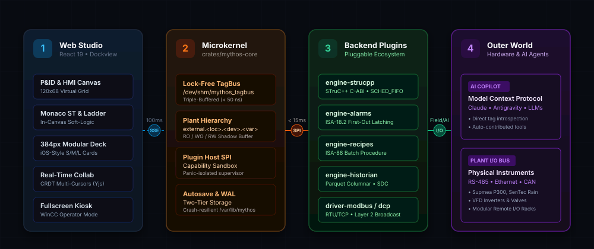

<p align="center">
  
</p>

# MythOS

<p align="center">
  <b>Next-Generation Open-Source Industrial SCADA &amp; Soft-Logic Platform</b>
</p>
<p align="center">
  A pure Rust microkernel uniting real-time STruC++ soft-logic execution, a modern collaborative web studio, and native AI automation.
</p>

<div align="center">

  
  
  
  

</div>

<p align="center">
  <sub>Engineered by <a href="https://github.com/adrianaryaputra">adrianaryaputra</a> for <a href="https://firmansyah.co">firmansyahco</a></sub>
</p>

<br>

## &nbsp; The Problem
Traditional SCADA and PLC engineering platforms (Siemens WinCC, Wonderware InTouch, Rockwell FactoryTalk) have been stagnant for decades. They trap industrial operations in expensive, monolithic silos.

<table width="100%">
  <tr>
    <td width="33%" valign="top">
      <h3 align="center">&nbsp; Monolithic Lock-In</h3>
      <p align="center">Closed binaries, multi-gigabyte Windows-only installers, and proprietary SDKs. Modifying a driver or adding a custom calculation requires recompiling the entire runtime.</p>
    </td>
    <td width="33%" valign="top">
      <h3 align="center">&nbsp; Fragile Addressing</h3>
      <p align="center">Flat numeric registers (e.g. <code>40001</code>, <code>%IW100</code>) lead to silent address collisions, unmaintainable code, and high failure rates during field commissioning.</p>
    </td>
    <td width="33%" valign="top">
      <h3 align="center">&nbsp; Zero Collaboration</h3>
      <p align="center">Single-user project file locking from the 1990s. Engineers cannot work together concurrently, and autonomous AI agents have zero direct access to control loops.</p>
    </td>
  </tr>
</table>

<br>

## &nbsp; The Solution
MythOS treats supervisory control as a **deterministic data-flow and pluggable microkernel problem**. 

The core kernel does only three things: manages a lock-free POSIX shared memory tag bus, supervises capability-sandboxed plugins, and exposes a native Model Context Protocol (MCP) server. **Everything else—drivers, logic engines, calculation pipelines, and GUI workspaces—is a hot-swappable plugin.**

<p align="center">
  
</p>

### How it works

1. **Lock-Free TagBus (`/dev/shm/mythos_tagbus`):** Process values flow through a triple-buffered POSIX shared memory ring. Atomic pointer swaps take less than 50 nanoseconds, guaranteeing zero thread contention and sub-millisecond I/O determinism.
2. **Embedded STruC++ Logic Engine:** IEC 61131-3 programs (ST, LD, FBD, SFC, IL) compile into native `.so` libraries using the STruC++ compiler. The runtime executes them in dedicated Linux `SCHED_FIFO` real-time threads (priority 85) with bumpless hot-reload in under 50 ms.
3. **Decoupled Plant Hierarchy:** Tags are addressed via physical plant topology: `external.<namespace>.<device>.<variable>[.<subfield>]` (e.g. `external.BoilerRoom.PT101.pressure.pv`). The `external` prefix is strictly reserved for physical field instruments.
4. **Autonomous AI Copilot (MCP Native):** An embedded Model Context Protocol server (stdio and SSE) allows external AI assistants (Claude, Antigravity, local LLMs) to query live telemetry, discover devices, and co-engineer logic under strict capability guards.
5. **Real-Time Collaborative Studio:** Multiple engineers can work on the same plant simultaneously over LAN. The web studio features CRDT document synchronization (Yjs / `yrs`) with live multi-cursors in Monaco and collaborative HMI drag-and-drop.

<br>

## &nbsp; Breakthrough Features

<table width="100%">
  <tr>
    <td width="50%" valign="top">
      <h4>&nbsp; "Everything is a Plugin" Harness</h4>
      <p>Inspired by modern extensibility frameworks. Fieldbus drivers, process engines, discovery scanners, and UI widgets are independent plugins. Built-in features follow the exact same contract as community extensions.</p>
    </td>
    <td width="50%" valign="top">
      <h4>&nbsp; Full 5-Language IEC 61131-3</h4>
      <p>Full support for Structured Text (ST), Ladder Diagram (LD), Function Block Diagram (FBD), Sequential Function Chart (SFC), and Instruction List (IL) powered by pluggable compiler backends.</p>
    </td>
  </tr>
  <tr>
    <td width="50%" valign="top">
      <h4>&nbsp; Universal Protocol Auto-Discovery</h4>
      <p>Layer 2 PROFINET DCP raw Ethernet broadcasts find unconfigured devices across subnets without IP addresses. Serial fieldbus sweeps probe baud rates, parities, and slave IDs automatically.</p>
    </td>
    <td width="50%" valign="top">
      <h4>&nbsp; Constant Virtual Grid Scaling</h4>
      <p>A constant 120 × 67.5 logical grid scales adaptively to any screen. P&amp;ID schematics and operator cards maintain 100% geometric composition on 4K video walls, laptops, tablets, and phones.</p>
    </td>
  </tr>
  <tr>
    <td width="50%" valign="top">
      <h4>&nbsp; TIA Portal-Style 3-Stage HMI</h4>
      <p>Decoupled screen hierarchy with a strict 3-stage lifecycle: <b>Edit View</b> (draft staging buffer) ➔ <b>Preview Mode</b> (non-actuating simulation) ➔ <b>Deploy to Runtime</b> (atomic production release).</p>
    </td>
    <td width="50%" valign="top">
      <h4>&nbsp; iOS-Style 2-Column Modular Deck</h4>
      <p>A standardized 384px fixed-width companion drawer partitioned into two columns. Houses modular Size S (184×96), Size M (384×192), and Size L (384×384) cards with swipeable smart widget stacks.</p>
    </td>
  </tr>
  <tr>
    <td width="50%" valign="top">
      <h4>&nbsp; Enterprise Process Engines</h4>
      <p>Native ANSI/ISA-18.2 Alarm state machine with nanosecond First-Out latching and chatter suppression; ANSI/ISA-88 Batch Recipe manager; and Swinging Door Compression Parquet Historian (&gt; 90% data reduction).</p>
    </td>
    <td width="50%" valign="top">
      <h4>&nbsp; Immersive Fullscreen WinCC Kiosk</h4>
      <p>One-click expansion to pure fullscreen kiosk mode hiding 100% of engineering IDE chrome. Exit runtime is protected by an IEC 62443 role-based credential challenge.</p>
    </td>
  </tr>
</table>

<br>

## &nbsp; Tech Stack

| **Component** | **Technology** | **Description** |
| :--- | :--- | :--- |
| **Microkernel Core** |  | Pure Rust microkernel: Tokio async actors, POSIX shared memory, and capability security proxy. |
| **Soft-Logic Engine** |  | Embedded STruC++ compiler pipeline emitting native C-ABI `.so` executed under Linux `SCHED_FIFO`. |
| **Web Studio** |  | React 19, Vite 6, TypeScript, Tailwind CSS, Dockview 5-zone shell, Monaco Editor, and xyflow. |
| **Collaboration** |  | Conflict-Free Replicated Data Types (CRDT) via `yrs` on the backend and `yjs` / `y-monaco` on the web. |
| **Transport &amp; Gateway** |  | Axum 0.7 REST API, 100ms throttled SSE telemetry stream, and high-frequency binary WebSockets. |
| **AI Copilot** |  | Model Context Protocol (MCP) server with compile-time `#[mythos_mcp_tool]` auto-registration. |
| **Historian &amp; Storage** |  | Apache Arrow &amp; Parquet with Boxcar-Swinging Door Compression (SDC) and append-only WAL. |

<br>

## &nbsp; Repository Codebase Structure

MythOS is architected as an **independent Cargo Workspace** and **modular plugin ecosystem**. The codebase is cleanly partitioned into dedicated functional domains:

<table width="100%">
  <thead>
    <tr>
      <th align="left" width="28%">Directory / Domain</th>
      <th align="center" width="14%">Type</th>
      <th align="left" width="58%">Responsibilities &amp; Architecture Role</th>
    </tr>
  </thead>
  <tbody>
    <tr>
      <td>
        &nbsp;
        <a href="crates/"><code>crates/</code></a>
      </td>
      <td align="center">
        
      </td>
      <td>
        <strong>Hardened Rust Microkernel &amp; SDK Core</strong><br>
        Hosts the lock-free shared memory TagBus (<code>mythos-shm</code>), capability security proxy, plugin host supervisor (<code>mythos-plugin-sdk</code>), atomic WAL autosave, and the native AI Model Context Protocol server (<code>mythos-mcp</code>).
      </td>
    </tr>
    <tr>
      <td>
        &nbsp;
        <a href="plugins/"><code>plugins/</code></a>
      </td>
      <td align="center">
        
      </td>
      <td>
        <strong>Universal Backend Plugins (Everything is a Plugin)</strong><br>
        <code>drivers/</code>: Hot-swappable fieldbus communication (Modbus RTU/TCP, MQTT Sparkplug B).<br>
        <code>engines/</code>: Pluggable industrial engines: embedded STruC++ soft-logic (<code>engine-strucpp</code>), ANSI/ISA-18.2 alarms, ANSI/ISA-88 recipes, Parquet historian, and Layer 2 DCP discovery.
      </td>
    </tr>
    <tr>
      <td>
        &nbsp;
        <a href="frontend/"><code>frontend/</code></a>
      </td>
      <td align="center">
        
      </td>
      <td>
        <strong>Modular UI Extension Host &amp; Canvas Plugins</strong><br>
        <code>packages/ui-shell/</code>: React 19, Vite 6, and Dockview 5-zone workspace host.<br>
        <code>plugins/</code>: Pluggable GUI modules: xyflow network topology, Monaco ST/Ladder studio, ISA-101 HMI canvas, Faceplate library designer, 384px iOS-style widget deck, and global alarm banner.
      </td>
    </tr>
    <tr>
      <td>
        &nbsp;
        <a href="catalog/"><code>catalog/</code></a>
      </td>
      <td align="center">
        
      </td>
      <td>
        <strong>Open Hardware Device Catalog Packages</strong><br>
        Community and vendor device definitions (YAML/JSON manifests and vector SVG thumbnails) with automated register mapping, scale ranges, and probe discovery fingerprints (Supmea P300, SenTec Rain).
      </td>
    </tr>
    <tr>
      <td>
        &nbsp;
        <a href="specs/"><code>specs/</code></a>
      </td>
      <td align="center">
        
      </td>
      <td>
        <strong>Formal Specifications &amp; Architectural Records</strong><br>
        Master System Specification (<code>spec.md</code>, ISO 29148 compliant, 85 SyRS clauses), Agile Work Breakdown Structure (<code>tasks.md</code>, 6 Sprints), and Architectural Decision Records (<code>adr/ADR-001..008</code>).
      </td>
    </tr>
    <tr>
      <td>
        &nbsp;
        <a href="docs/"><code>docs/</code></a>
      </td>
      <td align="center">
        
      </td>
      <td>
        <strong>In-Depth Technical Architecture Handbooks</strong><br>
        Comprehensive handbooks covering the microkernel, STruC++ FFI bridge, OpenAPI/SSE/WS endpoints, plant tag namespace, W3C DTCG tokens, and disaster recovery.
      </td>
    </tr>
  </tbody>
</table>

<br>

## &nbsp; Universal Multi-Platform Installation

MythOS is completely **OS-Agnostic**. Installing MythOS on Windows, macOS, Linux, or Docker is as effortless as installing any modern consumer software:

<table width="100%">
  <thead>
    <tr>
      <th align="left" width="22%">Platform</th>
      <th align="center" width="20%">Distribution Package</th>
      <th align="left" width="58%">Installation Method</th>
    </tr>
  </thead>
  <tbody>
    <tr>
      <td>
        &nbsp;
        <strong>Windows 10 / 11</strong>
      </td>
      <td align="center">
        <a href="https://github.com/firmansyahco/mythos/releases">
          
        </a>
      </td>
      <td>
        <strong>1-Click Graphical Installer</strong>: Download and run <code>MythOS-Setup-x64.exe</code>. Bundles the standalone microkernel daemon, embedded web studio, and pre-packaged C++ compilers with zero manual prerequisites.
      </td>
    </tr>
    <tr>
      <td>
        &nbsp;
        <strong>macOS (Universal)</strong>
      </td>
      <td align="center">
        <a href="https://github.com/firmansyahco/mythos/releases">
          
        </a>
      </td>
      <td>
        <strong>Drag-and-Drop DMG</strong>: Open <code>MythOS-Universal.dmg</code> and drag to <code>/Applications</code>. Native Apple Silicon (M1/M2/M3/M4) &amp; Intel Universal 2 binary with native Cocoa WebViews and Apple notarization.
      </td>
    </tr>
    <tr>
      <td>
        &nbsp;
        <strong>Linux Desktops</strong>
      </td>
      <td align="center">
        <a href="https://github.com/firmansyahco/mythos/releases">
          
        </a>
      </td>
      <td>
        <strong>Portable Zero-Install</strong>: <code>chmod +x MythOS-x86_64.AppImage &amp;&amp; ./MythOS-x86_64.AppImage</code>. Runs on any distribution (Ubuntu, Debian, Fedora, Arch). Also available as native <code>.deb</code> and <code>.rpm</code> packages.
      </td>
    </tr>
    <tr>
      <td>
        &nbsp;
        <strong>Docker / Cloud</strong>
      </td>
      <td align="center">
        <a href="https://hub.docker.com/r/firmansyahco/mythos">
          
        </a>
      </td>
      <td>
        <strong>Instant 10-Second Container Launch</strong>:<br>
        <code>docker compose up -d</code> using the bundled <a href="compose.yaml"><code>compose.yaml</code></a> or <code>docker run -d --net=host --ipc=host firmansyahco/mythos:latest</code>.
      </td>
    </tr>
    <tr>
      <td>
        &nbsp;
        <strong>Headless Field IPC</strong>
      </td>
      <td align="center">
        
      </td>
      <td>
        <strong>Single-Command Automated Bootstrap</strong> (Raspberry Pi 4/5, CM4, Advantech, Siemens IPC):<br>
        <code>curl -fsSL https://get.mythos.firmansyah.co | sudo bash</code> (Auto-detects CPU, provisions systemd service).
      </td>
    </tr>
  </tbody>
</table>

<br>

### Development from Source
Ensure your build environment meets the following requirements:
* **Operating System:** Linux (Ubuntu 22.04+, Debian 12+, Arch Linux) with POSIX shared memory enabled (`/dev/shm`). macOS and Windows are supported for offline HMI design and testing.
* **Rust Toolchain:** Rust 1.82.0 or newer (`cargo`, `rustc`).
* **Node.js Environment:** Node.js 22.x LTS and `pnpm` 9.x+ (for the frontend studio).
* **C/C++ Compiler:** Clang 16+ or GCC 12+ (for compiling native soft-logic shared libraries).
* **Network Permissions:** `CAP_NET_RAW` capability (required only when executing Layer 2 PROFINET DCP discovery).

### 2. Building from Source

```bash
# Clone the repository
git clone https://github.com/firmansyahco/mythos.git
cd mythos

# Build all microkernel crates and first-party plugins
cargo build --release

# Build the frontend studio
cd frontend/packages/ui-shell
pnpm install
pnpm build
cd ../../../
```

### 3. Running the Microkernel Daemon

```bash
# Launch the MythOS industrial daemon in local development mode
./target/release/mythos-server --run

# Open the engineering studio in your browser
# URL: http://localhost:8080
```

<br>

## &nbsp; Standards &amp; Regulatory Compliance

| **Standard** | **Authority** | **Scope &amp; Adherence in MythOS** |
| :--- | :--- | :--- |
| **IEC 61131-3** | IEC | Full 5-language soft-logic execution (ST, LD, FBD, SFC, IL) via STruC++ compiler plugin. |
| **ANSI/ISA-101.01** | ISA | High-performance situational awareness HMI graphics with dual-theme W3C DTCG tokens. |
| **ANSI/ISA-18.2** | ISA | Alarm management lifecycle, First-Out nanosecond latching, and chatter suppression. |
| **ANSI/ISA-88.01** | ISA | Batch control architecture decoupling Formula setpoints from PackML procedure sequences. |
| **IEC 62443-4-2** | IEC | 5-level Role-Based Access Control, audit logging, and secure Kiosk runtime exit handshakes. |
| **ISO/IEC/IEEE 29148** | ISO/IEEE | Systems and software engineering requirements engineering compliance. |
| **Model Context Protocol** | Anthropic / Open | Native Model Context Protocol (MCP) server for autonomous AI agent co-engineering. |

<br>

## &nbsp; Licensing &amp; Governance

MythOS is licensed under the **Mozilla Public License, Version 2.0 (MPL-2.0)**.

```
Copyright (c) 2026 firmansyahco
Author: adrianaryaputra <adrian@firmansyah.co>
```

### Commercial &amp; Contribution Terms:
* **Commercial Freedom:** You are completely free to use, modify, distribute, package with hardware, and commercially sell systems running MythOS without paying royalties.
* **File-Level Copyleft (Reciprocity Invariant):** Any modifications, bug fixes, or enhancements made to existing MythOS source files **must be open-sourced and contributed back under MPL-2.0**.
* **Proprietary Plugin Freedom:** Independent modules, proprietary batch recipes, closed-source hardware drivers, or custom algorithms that communicate with MythOS via the `trait MythosPlugin` interface or network APIs are **NOT** infected by copyleft and may remain fully proprietary.

Full legal text is available in [LICENSE.md](LICENSE.md).

<br>

<p align="center">
  <sub>MythOS — Engineered for the future of open and autonomous industrial automation.</sub>
</p>
