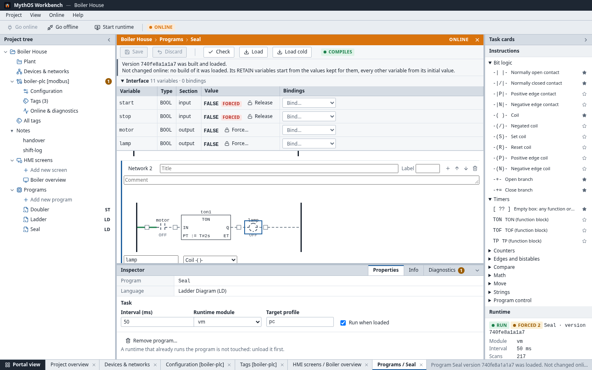
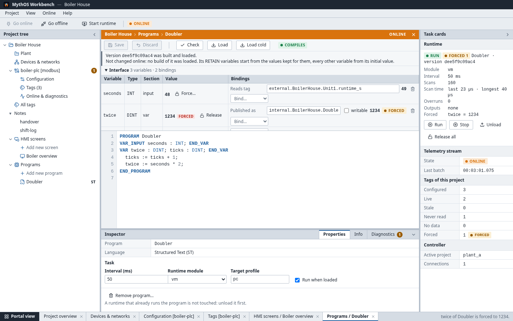
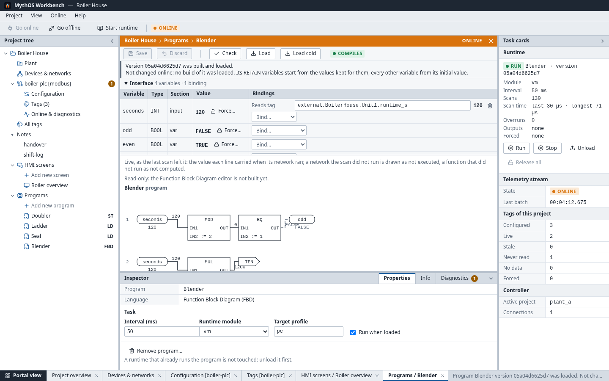
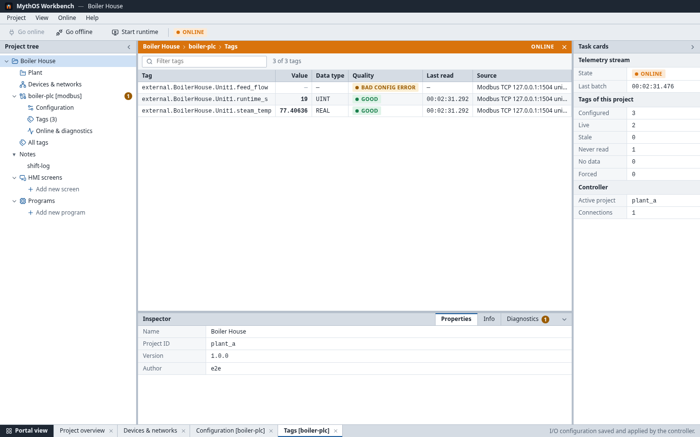
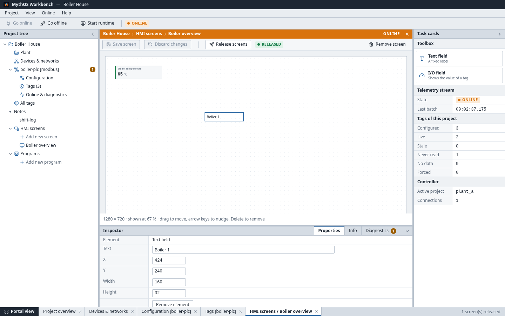
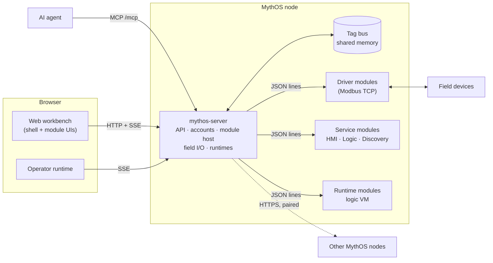

<p align="center">
  
</p>

<p align="center">
  <b>An open SCADA and soft-PLC platform: engineer, program and run a plant from your browser.</b>
</p>

<p align="center">
  <a href="https://github.com/firmansyah-co/mythos/actions/workflows/ci.yml"></a>
  <a href="LICENSE.md"></a>
  
  
  
  
</p>

<p align="center">
  
</p>

MythOS is a SCADA system and a soft PLC in one, written in Rust, with a web engineering
workbench in the spirit of TIA Portal. You connect field devices, write control programs in
IEC 61131-3 languages, draw operator screens, and watch it all run live, from one browser tab.

Everything is a module. Drivers, the HMI, the logic editor and the runtime are separate
processes that can be installed, disabled and swapped while the plant keeps running. Every
action the workbench can take is also available to AI agents over the Model Context Protocol.

> [!WARNING]
> **Early development. Do not use MythOS to run a real plant or as a safety system.** It has been
> exercised end to end against simulated devices, not against hardware. See
> [what is built](#what-is-built) and [what is not built yet](#what-is-not-built-yet).

## Highlights

- **IEC 61131-3 control logic, our own compiler.** Write programs in Structured Text, Ladder
  Diagram or Function Block Diagram. The compiler produces bytecode for a portable `no_std`
  virtual machine. That VM runs on a PC and, in CI, inside emulated ESP32-C3 and RP2040
  microcontrollers, and gives the same result scan by scan.
- **A workbench that feels like an engineering tool.** You get a project tree, editors, task
  cards, an inspector with diagnostics and a portal, all in the browser. The Ladder editor
  follows TIA Portal's workflow: instruction palette, favourites, networks, drag and drop.
- **Live and honest.** Values stream to the workbench every 100 ms with their quality. A value
  MythOS does not have is shown as `UNKNOWN` or `NOT MEASURED`, never as a guess. A forced variable
  is marked `FORCED` everywhere it appears.
- **Safe values by design.** Each output belongs to the program that writes it. Whenever that
  program is not running (stopped, faulted, its process gone or unloaded), the output is written
  its safe value until the device confirms it. RETAIN variables, a watchdog and online change
  without a bump are built in.
- **Modules all the way down.** Drivers, the HMI, logic, discovery and runtimes are processes.
  Settings → Modules installs a module from a checked package, disables it, enables it and
  removes it. A new build of a running module is swapped in without its tags stopping.
- **AI-native.** `POST /mcp` serves the Model Context Protocol. Every HTTP route is a tool,
  and a test fails the build when one is not, so an agent can do everything the workbench does,
  with its owner's role.
- **Many nodes, one plant.** Nodes find each other over mDNS and pair with a one-time code and a
  certificate fingerprint. A plant project then downloads each device's configuration to its
  node, compares what each node runs, and reads tags across devices over HTTPS.
- **Runs everywhere.** Linux, macOS and Windows are built and tested in CI. A node can run as a
  service under systemd, launchd or Windows Task Scheduler.

## A look around

| | |
| :---: | :---: |
|  |  |
| Structured Text with live values and forcing | A Function Block Diagram, drawn live |
|  |  |
| Devices & networks, live tags with quality | HMI screen editor |

## How it fits together



The design is recorded in the [architecture decisions](specs/adr/). The ones that shape it most
are [ADR-010](specs/adr/ADR-010-modules-are-processes.md) (modules are processes),
[ADR-011](specs/adr/ADR-011-the-core-and-service-modules.md) (the core and service modules),
[ADR-012](specs/adr/ADR-012-nodes-discovery-and-plant-projects.md) (nodes and plants) and
[ADR-013](specs/adr/ADR-013-logic-compiler-and-vm.md) (the logic compiler and VM).

## Quick start

You need Rust 1.82 or newer, Node.js 22 and pnpm, on Linux, macOS or Windows.

```bash
git clone https://github.com/firmansyah-co/mythos.git
cd mythos

# the server, the CLI and every module
cargo build --bin mythos-server --bin mythos --bin mythos-module-modbus --bin mythos-module-hmi \
  --bin mythos-module-logic --bin mythos-module-runtime-vm --bin mythos-module-discovery
(cd frontend && pnpm install --frozen-lockfile && pnpm build)

MYTHOS_STORAGE_ROOT="$PWD/.mythos-data" \
MYTHOS_STATIC_DIR="$PWD/frontend/packages/ui-shell/dist" \
  ./target/debug/mythos-server
```

Open <http://localhost:8080>. A new controller prints a one-time setup code in its log; enter it
to create the first administrator.

No hardware? Start a simulated Modbus TCP device and point a connection at `127.0.0.1:1502`.
**Its values are synthetic.**

```bash
cargo run -p driver-modbus --features sim --example modbus_sim -- 127.0.0.1:1502
```

[Getting started](docs/guides/getting-started.md) covers every setting, Windows, replacing a
module and verifying a change.

## What is built

| Area | What you can do today |
| :--- | :--- |
| Field I/O | Configure Modbus TCP connections in a form drawn from the driver's own schema. Read registers as typed, scaled values with quality, and write a value to a writable tag. |
| Control logic | Write, check, bind, build and load programs in Structured Text and Ladder Diagram, and load and watch Function Block Diagram programs. Then run, stop, watch and force them, with RETAIN, a watchdog and online change. |
| HMI | Draw screens with text and I/O fields bound to tags, release them, and open the full-window operator runtime. |
| Modules | Install, disable, enable, remove and hot-swap drivers, service modules and runtimes. |
| Nodes and plants | Run a node as a workstation, edge or server, discover and pair nodes, download and compare a plant's devices, and read tags across them. |
| Platform | Accounts with four roles, HTTPS with the node's own certificate, an MCP endpoint, a `mythos` CLI with service install and updates. CI on Linux, macOS and Windows. |

The [feature reference](docs/guides/feature-reference.md) describes each piece in detail, with
where it lives in the tree.

## What is not built yet

- Drivers other than Modbus TCP (Modbus RTU, OPC UA, MQTT, …) and a device catalog for every protocol.
- A Function Block Diagram editor, Sequential Function Charts, and task configuration per runtime.
- Alarms, historian, trends and recipes. HMI graphics, faceplates on screens, and writes from a screen.
- A published release: `mythos update` and the one-line installers have nothing to install yet.

The plan after the control logic is complete: alarms and a historian, IEC 62443 security,
then OPC UA.

## Documentation

| Guide | |
| :--- | :--- |
| [Getting started](docs/guides/getting-started.md) | Build, run, first sign-in, environment variables, verifying a change |
| [Reading a field device](docs/guides/field-io.md) | The I/O configuration, how it is applied, the Modbus TCP fields |
| [Connecting an AI agent](docs/guides/ai-agents.md) | Access tokens and the MCP endpoint |
| [Installing and updating](docs/guides/installing-and-updating.md) | Release bundles, channels, pinning and rollback |
| [Feature reference](docs/guides/feature-reference.md) | Everything that runs, piece by piece, and the repository layout |
| [Design documents](docs/README.md) | Architecture, data and HMI designs, each marked with what of it is built |

## Contributing

Read [`CLAUDE.md`](CLAUDE.md) and [`CONTRIBUTING.md`](CONTRIBUTING.md) first. Work goes on a
branch cut from `dev`, one slice per pull request, and every claim in a pull request carries the
output that proves it. `./scripts/check.sh` runs the same gate as CI.

## License

[Mozilla Public License 2.0](LICENSE.md). Copyright © 2026 firmansyahco.

<p align="center">
  <sub>Engineered by <a href="https://github.com/adrianaryaputra">adrianaryaputra</a> for <a href="https://firmansyah.co">firmansyahco</a></sub>
</p>
